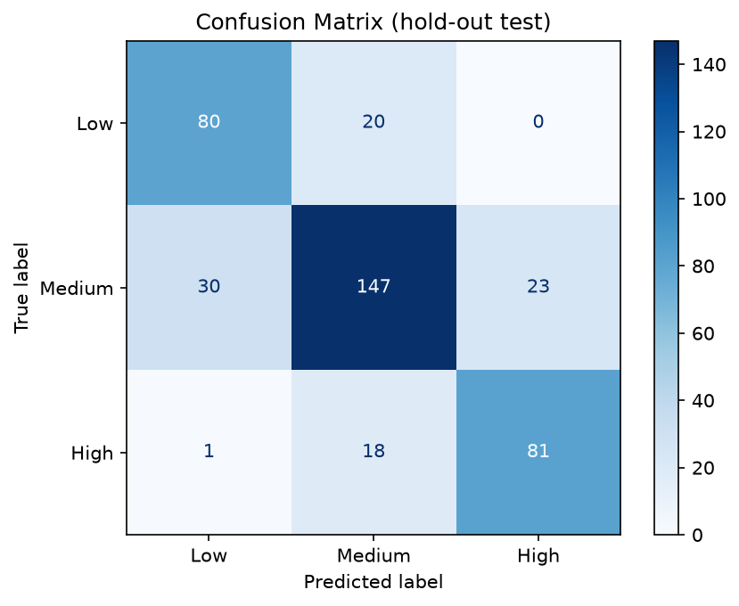
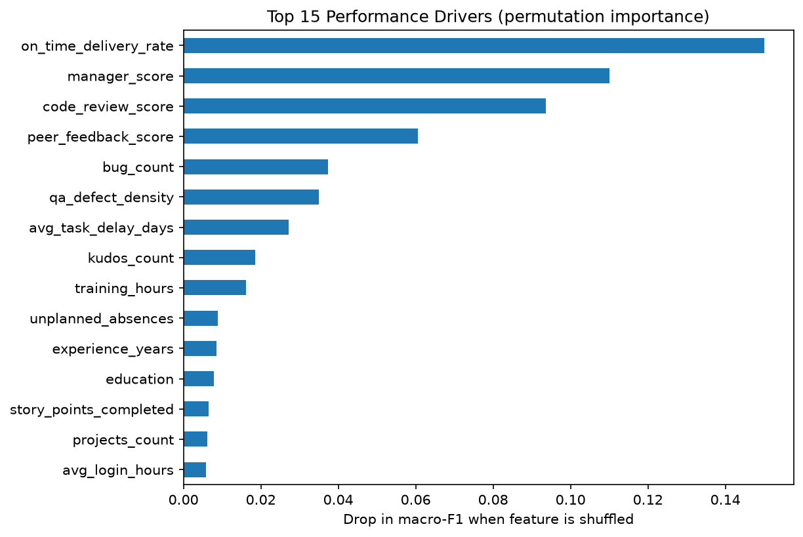
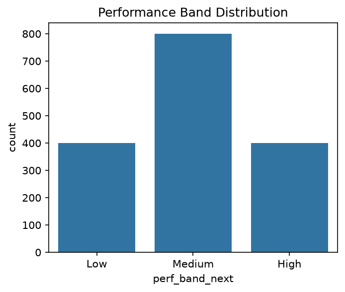
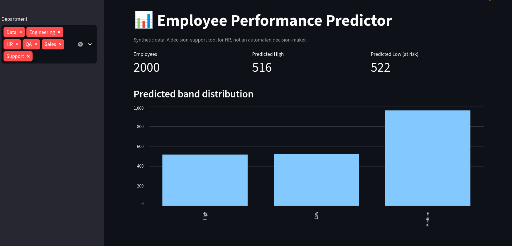

# 📊 Employee Performance Predictor using Data Analytics

Predicts an employee's **next-cycle performance band (High / Medium / Low)** from
work, quality, attendance and feedback signals, explains the main drivers, audits
fairness across groups, and suggests coaching actions for HR and managers.

> ⚠️ Built on **synthetic data** generated by a documented rule. No real employee data is used.

## Problem Statement
Appraisal cycles are reactive: by the time a low rating appears, there is little time
to help the employee. This project forecasts the band 1-2 months ahead so managers and
HR can intervene early with targeted coaching or training.

## Business Value
- Early coaching for employees at risk of a Low rating
- Targeted L&D spend instead of blanket training
- Support for appraisal calibration (decision support, not automated decisions)
- Built-in fairness audit across gender, department and job level

## Tech Stack
Python · Pandas · NumPy · scikit-learn · Matplotlib · Seaborn · Streamlit · joblib

## Architecture
```
Synthetic data -> Validation -> EDA -> Pipeline (impute / scale / encode)
-> Logistic Regression vs Random Forest -> Evaluation -> Permutation importance
-> Fairness audit -> Recommendation engine -> Streamlit dashboard
```

## How to Run
```bash
git clone https://github.com/arppitha-ai/Employee-Performance-Predictor.git
cd Employee-Performance-Predictor
python3 -m venv venv
source venv/bin/activate          # Windows: venv\Scripts\activate
pip install -r requirements.txt
python main.py                    # data -> EDA -> train -> evaluate -> fairness -> action plans
streamlit run app.py              # dashboard at http://localhost:8501
```

## Methodology
1. Synthetic data for 2,000 employees, 26 features, ~3% missing values in 3 columns
2. EDA on the training split only (80/20 stratified split)
3. Leakage-safe scikit-learn Pipeline; `employee_id` and `gender` excluded from model inputs
4. Baseline Logistic Regression vs grid-searched Random Forest, 5-fold CV, macro-F1
5. Permutation importance on the full pipeline for global drivers
6. Group fairness audit (High-band selection rate, F1, four-fifths rule)
7. Rule-based recommendation engine producing 30-day action plans

## Results
| Model | 5-fold CV macro-F1 |
|---|---|
| Logistic Regression (balanced) | [FILL] |
| Random Forest (tuned) | [FILL] |

Final model saved: **[Logistic Regression / Random Forest]**.

Hold-out test set (400 employees): **Accuracy [FILL], Macro-F1 [FILL]**

| Band | Precision | Recall | F1 |
|---|---|---|---|
| Low | [FILL] | [FILL] | [FILL] |
| Medium | [FILL] | [FILL] | [FILL] |
| High | [FILL] | [FILL] | [FILL] |

Top drivers (permutation importance): [FILL top 5 from outputs/feature_importance.csv]





## Fairness Audit
[FILL: one or two sentences from outputs/fairness_report.csv. Mention any group with a
disparate_impact below 0.8 and note small groups can be noisy.]

## Dashboard


## Limitations
- Labels come from a simulated formula, so the model recovers that rule. The metrics
  demonstrate the pipeline, not real-world accuracy.
- Permutation importance shows association, not causation.
- Real deployment needs privacy review, bias audits and human decision-making.

## Future Work
Real or public HR dataset · SHAP per-employee explanations · attrition prediction ·
FastAPI service · MLflow tracking · drift monitoring (PSI) · temporal train/test split

## Author
Arppitha 
